<p align="center">
  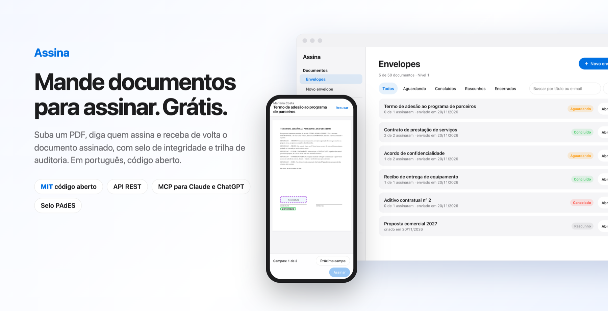
</p>

<p align="center">
  <a href="https://assina.app.br"><b>assina.app.br</b></a> ·
  <a href="https://assina.app.br/verificar">Verificar um documento</a> ·
  <a href="https://assina.app.br/docs/api">API</a> ·
  <a href="LICENSE">Licença MIT</a>
</p>

O **Assina** é uma plataforma de assinatura eletrônica de PDFs, grátis e em português. Você sobe o documento, diz quem assina e recebe de volta o PDF assinado, com o selo de integridade da plataforma, o manifesto com todas as assinaturas e a trilha de auditoria. Quem assina não precisa criar conta.

Tem **API REST** e **servidor MCP**, então sistemas e assistentes como o Claude e o ChatGPT também mandam documentos. O código é aberto, sob a licença MIT. É um produto da [DabLab](https://dablab.com.br).

## Como funciona

<p align="center">
  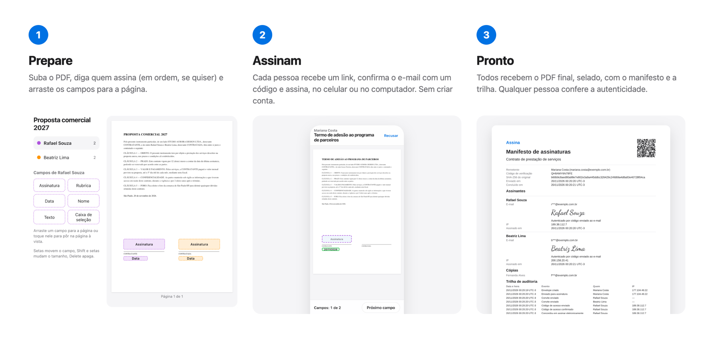
</p>

### Prepare o documento

Suba um PDF de até 10 MB e 100 páginas. Diga quem assina e quem só recebe cópia, em ordem ou todos ao mesmo tempo. Defina um prazo e se o Assina deve mandar lembretes automáticos. Arraste para a página os campos de cada pessoa: assinatura, rubrica, data, nome, texto e caixa de seleção.

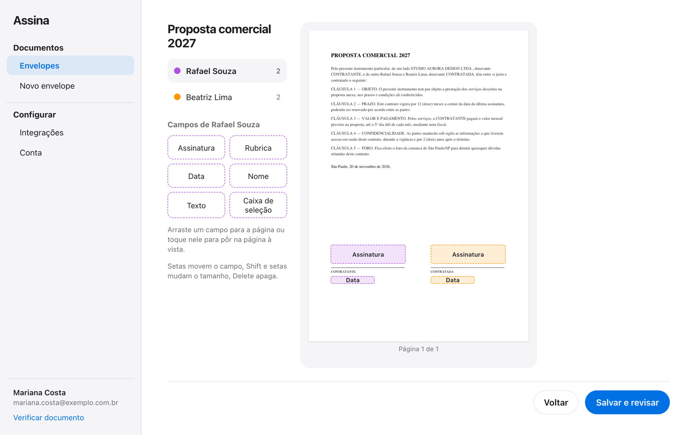

### Assinar sem conta

Quem assina recebe um link por e-mail e confirma que é dono do endereço com um código de 6 dígitos. Depois concorda em assinar eletronicamente, percorre os campos e assina digitando o nome, que vira letra cursiva, ou desenhando. Pode também recusar, dizendo o motivo.

<p align="center">
  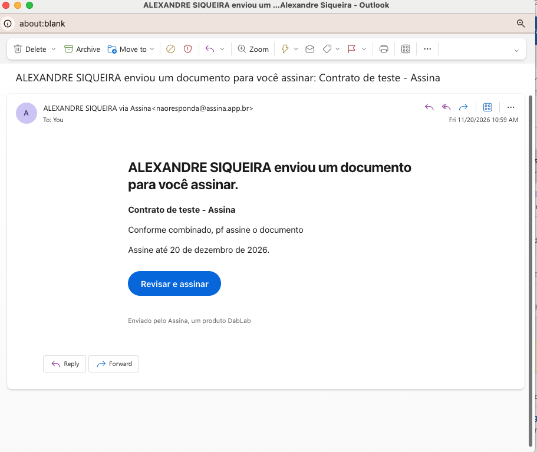
</p>

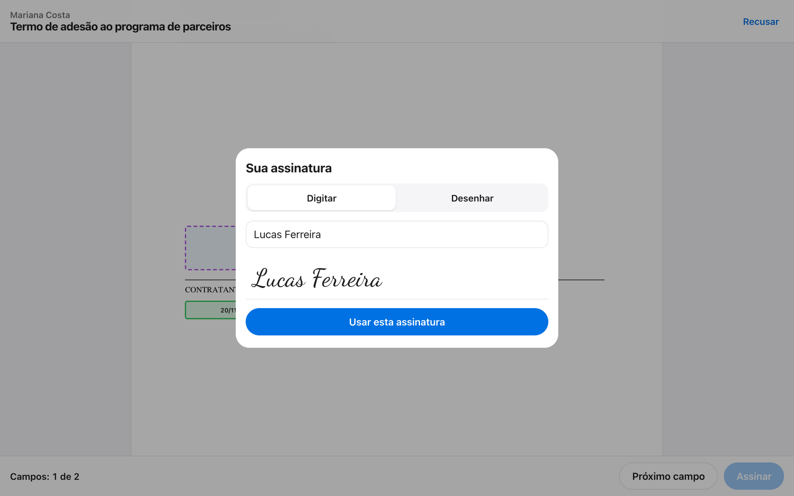

<p align="center">
  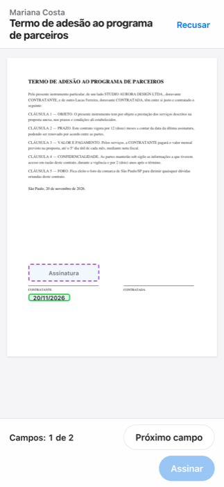
</p>

### Acompanhe cada envelope

O painel mostra cada envelope com o andamento ("1 de 2 assinaram"), filtros e busca. No detalhe estão quem já assinou, os botões para lembrar ou copiar o link de quem falta, os downloads e a trilha de auditoria: cada passo com a hora, o IP e o navegador, encadeado por hash, o que mostra se algo foi alterado.

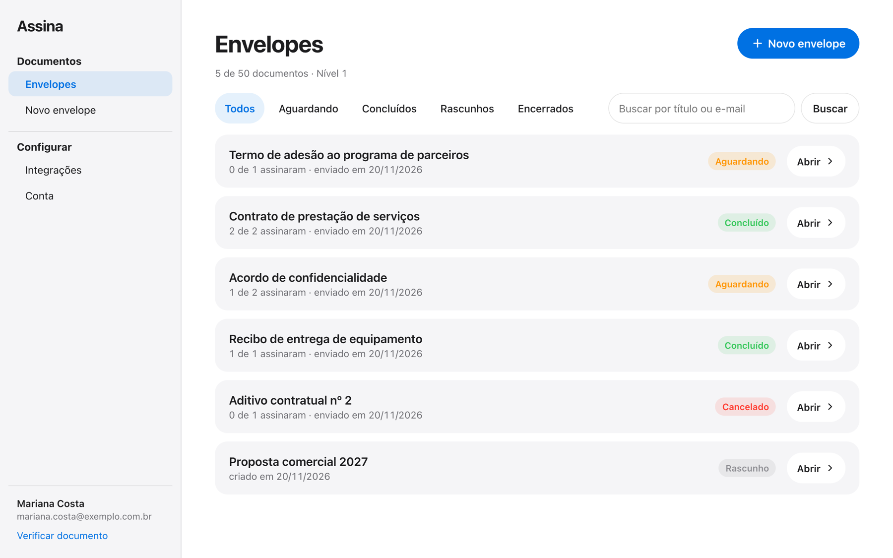

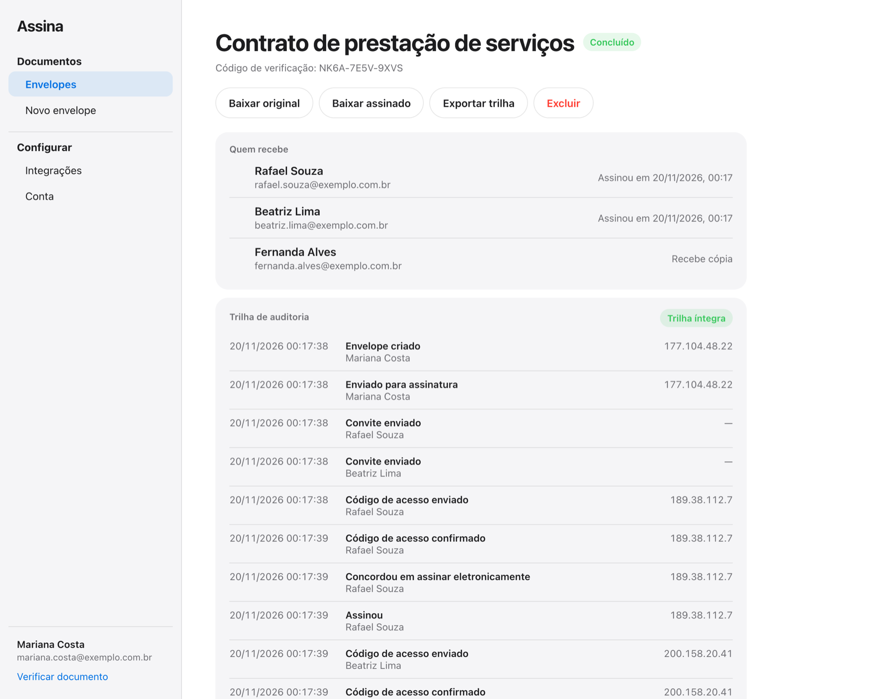

### Selado e verificável por qualquer pessoa

Quando a última pessoa assina, o Assina grava os campos no PDF, acrescenta o **manifesto** e aplica um **selo PAdES** da plataforma, com carimbo do tempo. Qualquer alteração depois disso aparece no leitor de PDF. Todos recebem o arquivo final por e-mail.

<p align="center">
  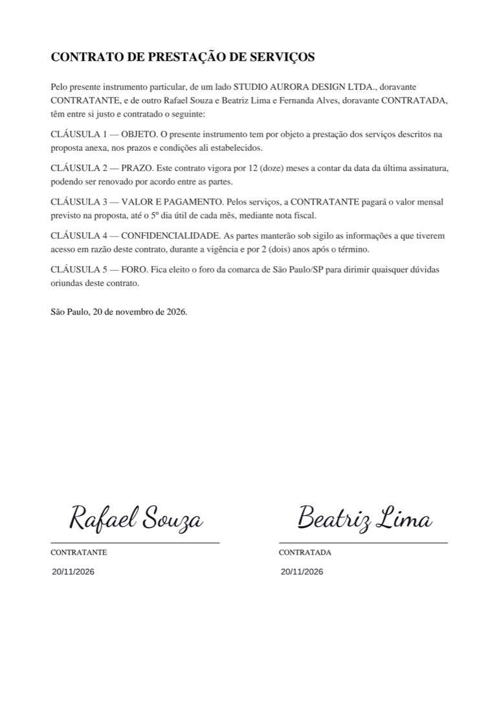
  &nbsp;
  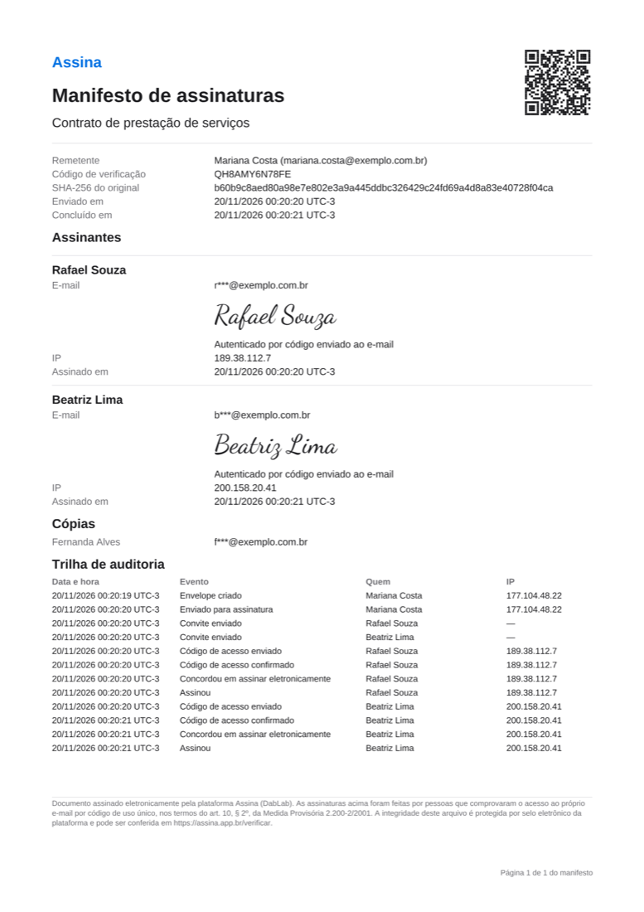
</p>

Em [assina.app.br/verificar](https://assina.app.br/verificar), qualquer pessoa confere um documento arrastando o PDF ou digitando o código do manifesto. O arquivo não sai do computador: o navegador calcula a impressão digital (SHA-256) e manda só ela.

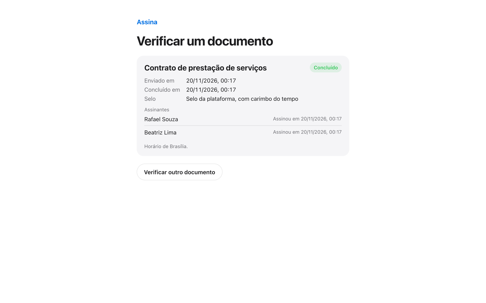

### Para sistemas e assistentes

- **API REST v1** com chave por conta: criar envelope (com o PDF por URL ou upload), enviar, acompanhar, lembrar, cancelar e baixar. O contrato está em OpenAPI 3.1, em [/docs/api](https://assina.app.br/docs/api).
- **Webhooks** assinados com HMAC: quem assinou, concluído, recusado, cancelado e expirado.
- **Servidor MCP** com login OAuth: conecte no Claude ou no ChatGPT, peça "manda este contrato para a Ana assinar" e acompanhe de lá. Criar o envelope só gera o rascunho; enviar é uma ação à parte, que o assistente pede para você confirmar.

No Claude, basta pedir em português. O conector lista e mostra os envelopes, cria o rascunho e devolve o link para posicionar os campos no painel. Na trilha de auditoria, o envelope aparece como criado pelo MCP.

<p align="center">
  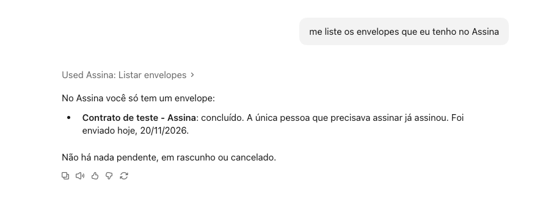
  &nbsp;
  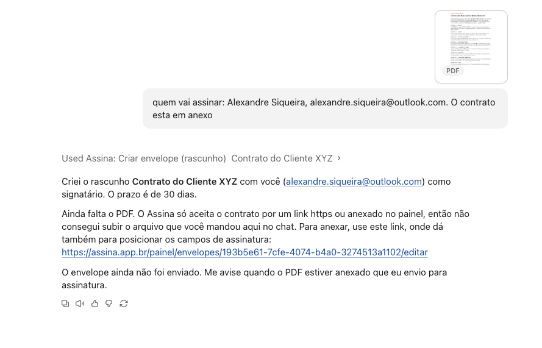
</p>

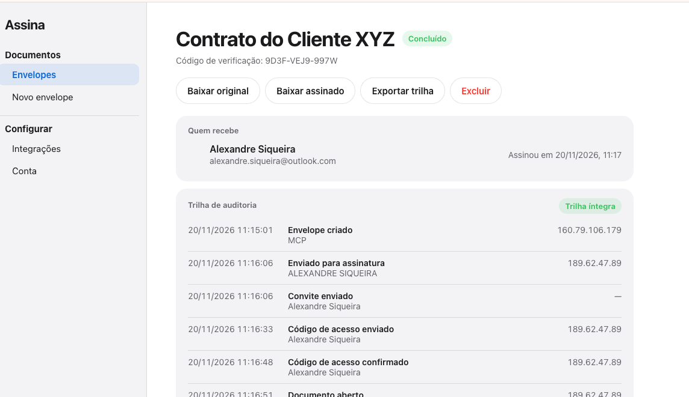

## O que o Assina é e o que não é

As assinaturas do Assina são **assinaturas eletrônicas**. A validade entre as partes se apoia no art. 10, § 2º, da Medida Provisória 2.200-2/2001, com a autoria comprovada pelo código enviado ao e-mail e a integridade garantida pelo selo e pela trilha. O Assina **não** faz assinatura com certificado ICP-Brasil e não substitui firma reconhecida. Para escrituras e atos que exigem esse certificado, use um cartório ou um certificado próprio. Detalhes nos [Termos de uso](https://assina.app.br/termos).

## Quanto custa

Usar em [assina.app.br](https://assina.app.br) é grátis, com limites para proteger o serviço: 30 envelopes enviados por dia por conta e 50 documentos guardados no nível 1.

Para rodar a sua própria instância, o Assina cabe nos planos gratuitos de Supabase, Cloudflare R2 e Resend (este com até 100 e-mails por dia). O plano gratuito da Vercel é para uso pessoal; em uso comercial, a Vercel pede o plano Pro.

## Stack técnica

- Next.js 16 (App Router, Cache Components) com React 19 e TypeScript
- Supabase (Postgres; RLS sem políticas, acesso só pelo servidor; regras e trilha encadeada em funções SQL)
- Cloudflare R2 para os arquivos (URLs assinadas)
- pdf-lib e pdf.js; selo PAdES com node-forge e carimbo do tempo RFC 3161
- Google OAuth (login), Resend (e-mails), Vercel (hospedagem e cron diário)
- MCP SDK com OAuth 2.1 e PKCE; zod; jose
- Vitest e pgTAP para testes

## Como foi construído

Desenvolvido com o Claude (Anthropic) a partir de uma especificação SDD: [spec.md](spec.md). Cada épico tem um plano em [plans/](plans/), e o que existe de fato está em [DOCUMENTACAO-TECNICA.md](DOCUMENTACAO-TECNICA.md).

- `npm run verify` roda typecheck, lint, guardrails, testes de banco (pgTAP) e de aplicação (Vitest), build e `npm audit`.
- Hooks do Claude Code em `.claude/hooks/` protegem migrations, segredos, testes e a copy (nada de prometer o que o Assina não é).
- Um agente verificador em `.claude/agents/` confere cada épico contra o spec antes do commit.
- Regras para o agente em [CLAUDE.md](CLAUDE.md).

| Arquivo | O que é |
|---|---|
| [`spec.md`](spec.md) | Especificação completa (fonte única de verdade) |
| [`DOCUMENTACAO-TECNICA.md`](DOCUMENTACAO-TECNICA.md) | O que está implementado de fato |
| [`CLAUDE.md`](CLAUDE.md) | Guia para sessões do Claude Code neste repositório |
| [`modelo-assina.dbml`](modelo-assina.dbml) | Modelo de dados para o dbdiagram.io |
| [`prompt-design-assina.md`](prompt-design-assina.md) | Prompt das telas para o Claude Design |
| [`PENDENCIAS.md`](PENDENCIAS.md) | O que ainda depende de conta, console ou decisão |
| [`THIRD_PARTY_NOTICES.md`](THIRD_PARTY_NOTICES.md) | Referência funcional e componentes de terceiros |

## Contribuições

Issues são bem-vindas: bugs, dúvidas e sugestões. Veja [CONTRIBUTING.md](CONTRIBUTING.md).

---

# Rodar e publicar

## Rodar localmente

Pré-requisitos: Node 22, Docker, [Supabase CLI](https://supabase.com/docs/guides/cli) e `jq` (os hooks do Claude Code usam).

```bash
npm install
supabase start                 # sobe o Postgres local nas portas 555xx e aplica as migrations
cp .env.example .env.local     # e preencha (ver abaixo)
npm run dev                    # http://localhost:3030
```

Em dev, sem R2 e sem Resend, os arquivos vão para `.armazenamento-local/` e os e-mails para `.caixa-de-saida-local/` (um `.txt` e um `.html` por e-mail). Em produção, sem R2 ou sem Resend, o app falha de propósito.

### Variáveis de ambiente

Todas no `.env.local` em dev e nas variáveis da Vercel em produção. Só `NEXT_PUBLIC_SITE_URL` é pública; o resto é segredo de servidor.

| Variável | Para quê | Como obter |
|---|---|---|
| `NEXT_PUBLIC_SITE_URL` | Endereço do site: links dos e-mails, OAuth, metadados do MCP, sitemap | `http://localhost:3030` em dev; `https://assina.app.br` em produção |
| `SUPABASE_URL`, `SUPABASE_SERVICE_ROLE_KEY` | Banco (service role; RLS sem políticas) | `supabase status -o env` em dev; painel do Supabase em produção |
| `GOOGLE_CLIENT_ID`, `GOOGLE_CLIENT_SECRET` | Login | Seção "Google Cloud" |
| `SESSION_SECRET` | Assina o cookie da sessão | `openssl rand -base64 32` |
| `CHAVES_ENC_KEY` | Cifra a chave de API e o segredo do webhook (AES-256-GCM) | `openssl rand -base64 32`. Trocar invalida as chaves guardadas |
| `CRON_SECRET` | Protege `/api/cron/diario` (a Vercel manda sozinha no cron) | `openssl rand -base64 32` |
| `EMAILS_PERMITIDOS`, `EMAILS_BLOQUEADOS`, `CONTAS_NOVAS_POR_DIA` | Proteções da regra 11.12: com a lista de permitidos preenchida, só quem está nela entra; os bloqueados nunca entram; contas novas por dia (padrão 50) | Listas separadas por vírgula |
| `ADMIN_EMAIL` | Recebe o alerta de finalização que falhou 3 vezes | E-mail da DabLab |
| `R2_ACCOUNT_ID`, `R2_ACCESS_KEY_ID`, `R2_SECRET_ACCESS_KEY`, `R2_BUCKET` | Arquivos | Seção "Cloudflare R2" |
| `RESEND_API_KEY`, `EMAIL_REMETENTE` | E-mails | Seção "Resend e DNS" |
| `SELO_P12_BASE64`, `SELO_P12_SENHA`, `SELO_TSA_URL` | Selo do PDF final | Seção "Selo do PDF final" |
| `VISAO_INGEST_URL`, `VISAO_API_KEY` | Eventos de uso (opcional) | Seção "Analytics no Visão do Produto" |

Se o Postgres local travar ou cancelar por timeout (`57014`), confira se outro Supabase local está ligado (`docker ps`) e pare-o: dois ao mesmo tempo sufocam o Docker.

## Verificação

```bash
npm run verify   # typecheck, lint, guardrails, pgTAP, Vitest, build e npm audit
```

Saída saudável: `29 de 29 casos ok` (guardrails), `Result: PASS` (pgTAP), `Tests N passed` (Vitest), a tabela de rotas do `next build` e `found 0 vulnerabilities`.

Outros comandos: `npm run db:types` (tipos do banco a partir do local) e `npm run db:schema` (regenera `supabase/schema.sql`).

## Banco

Projeto Supabase **compartilhado** com outros apps da DabLab (`jeesdmfcrmhyufwzwzwt`): todo objeto do Assina leva o prefixo `as_`. Migrations ficam em `supabase/migrations/` e vão ao remoto pelo MCP do Supabase (`apply_migration`, mesmo SQL do arquivo), **nunca** por `supabase db push`, que tentaria sincronizar o projeto inteiro. Depois de cada migration: advisors de segurança e performance filtrados a `as_*` e `npm run db:schema`.

## Google Cloud (login)

O Assina pede só `openid email profile`: escopos não sensíveis, sem verificação do Google. Fica num **projeto próprio "Assina"** na conta da DabLab, para a tela de consentimento mostrar o nome certo.

1. [console.cloud.google.com](https://console.cloud.google.com) → seletor de projeto → **Novo projeto** → nome `Assina` → Criar.
2. **APIs e serviços → Tela de consentimento OAuth** (Google Auth Platform) → **Começar**:
   - Nome do app: `Assina`; e-mail de suporte: `alexandre@dablab.com.br`.
   - Público: **Externo**.
   - Contato do desenvolvedor: `alexandre@dablab.com.br`.
3. **Marca** (Branding): página inicial `https://assina.app.br`, política de privacidade `https://assina.app.br/privacidade`, termos `https://assina.app.br/termos`, domínio autorizado `assina.app.br`. As três páginas existem desde o épico 8.12 e só respondem depois do deploy.
4. **Acesso a dados** (escopos): só `openid`, `.../auth/userinfo.email` e `.../auth/userinfo.profile`. Nenhum escopo sensível.
5. **Público** → **Publicar app** (status "Em produção"). Com escopos básicos não há revisão do Google nem limite de 100 usuários de teste.
6. **Clientes** → **Criar cliente** → tipo **Aplicativo da Web**, nome `Assina web`:
   - Origens JavaScript autorizadas: `http://localhost:3030` e `https://assina.app.br`.
   - URIs de redirecionamento autorizados: `http://localhost:3030/api/auth/google/callback` e `https://assina.app.br/api/auth/google/callback`.
7. Copie o **ID do cliente** e a **Chave secreta** para `GOOGLE_CLIENT_ID` e `GOOGLE_CLIENT_SECRET` no `.env.local` (e, no deploy, nas variáveis da Vercel).

## Cloudflare R2 (arquivos, a partir do épico 8.2)

1. Painel da Cloudflare (conta DabLab) → **R2** → **Criar bucket** → nome `assina-documentos`, sem acesso público e sem domínio `r2.dev`.
2. No bucket → **Configurações → Política de CORS**:

   ```json
   [{ "AllowedOrigins": ["https://assina.app.br", "http://localhost:3030"], "AllowedMethods": ["GET", "PUT"], "AllowedHeaders": ["content-type"], "MaxAgeSeconds": 3600 }]
   ```

3. **R2 → Gerenciar tokens de API → Criar token**: permissão **Leitura e gravação de objetos**, restrito ao bucket `assina-documentos`.
4. Copie para `R2_ACCOUNT_ID`, `R2_ACCESS_KEY_ID`, `R2_SECRET_ACCESS_KEY` e `R2_BUCKET`.

## Resend e DNS (e-mails)

O remetente técnico é `naoresponda@assina.app.br`, com o nome "{remetente} via Assina" e o `reply-to` de quem mandou o documento (seção 15.2).

1. [resend.com](https://resend.com) (conta DabLab) → **Domains → Add domain** → `assina.app.br`, região São Paulo (`sa-east-1`).
2. No DNS do `assina.app.br`, crie os registros que o Resend mostrar. Os nomes e valores exatos vêm do painel:
   - **SPF:** um `MX` e um `TXT` no subdomínio de envio que ele indicar (por exemplo, `send`);
   - **DKIM:** um `TXT` em `resend._domainkey`;
   - **DMARC:** um `TXT` em `_dmarc` com `v=DMARC1; p=none; rua=mailto:alexandre@dablab.com.br`. Depois de algumas semanas sem falhas, passe para `p=quarantine`.
3. Espere o domínio ficar **Verified** no Resend.
4. **API Keys → Create API key**, com permissão **Sending access** restrita ao domínio. Ponha em `RESEND_API_KEY`, e `EMAIL_REMETENTE=naoresponda@assina.app.br`.
5. Para conferir, mande um envelope de teste para um e-mail seu e veja no Gmail, em "Mostrar original", se SPF, DKIM e DMARC aparecem como `PASS`.

O plano grátis do Resend tem limite diário de envios; a decisão sobre o plano pago é a pergunta 25.4 do spec.

## Selo do PDF final (épico 8.6)

O PDF final leva um selo PAdES da plataforma (regra 11.10). O selo só garante a integridade do arquivo; não é a assinatura de quem assinou.

1. **Certificado.** Decisão 25.2: autoassinado no lançamento. O comando imprime `SELO_P12_BASE64=…` e `SELO_P12_SENHA=…` e não grava nenhum arquivo.
   - **Dev:** `npm run selo:gerar` gera o certificado "Assina (dev)". Cole as duas linhas no `.env.local`.
   - **Produção:** `npm run selo:gerar -- --producao` gera o certificado "Assina", o nome que o leitor de PDF mostra no selo. Ponha as duas linhas nas variáveis da Vercel e guarde uma cópia num cofre de senhas.

   Com o autoassinado, o Adobe Reader mostra "identidade desconhecida", o que é esperado. Trocar o certificado depois (por exemplo, por um e-CNPJ A1) não invalida os PDFs já selados.
2. **Carimbo do tempo (opcional).** `SELO_TSA_URL` com uma TSA RFC 3161 gratuita. Em 17/11/2026 responderam em cerca de 0,5 s: `http://timestamp.digicert.com`, `https://freetsa.org/tsr` e `http://timestamp.sectigo.com`. Com resposta em até 5 s, o selo é `B-T`; sem resposta, `B-B`, e o envelope conclui do mesmo jeito.
3. **Alerta.** `ADMIN_EMAIL` recebe o "[Assina] Finalização falhou 3 vezes".
4. **Conferir um PDF selado.** Basta abrir no Adobe Reader. Pela linha de comando:

   ```bash
   python3 -c "import re,sys;b=open(sys.argv[1],'rb').read();a,l,c,d=map(int,list(re.finditer(rb'/ByteRange\s*\[\s*(\d+)\s+(\d+)\s+(\d+)\s+(\d+)',b))[-1].groups());open('c.bin','wb').write(b[a:a+l]+b[c:c+d]);open('s.der','wb').write(bytes.fromhex(b[a+l+1:c-1].decode()))" final.pdf
   openssl cms -verify -binary -inform DER -in s.der -content c.bin -noverify -purpose any -out /dev/null
   ```

## API REST v1 e webhooks (épico 8.9)

A documentação legível fica em `/docs/api`, e o contrato em `/api/v1/openapi.json` (OpenAPI 3.1). A chave de API de cada conta está em **Integrações** (`Authorization: Bearer assina_…`). Gerar uma nova chave revoga a anterior na hora.

Fluxo completo por `curl`:

```bash
# 1. Criar com o PDF numa URL https (ou sem arquivo_url, para receber a upload_url)
curl -s -X POST https://assina.app.br/api/v1/envelopes \
  -H "Authorization: Bearer $ASSINA_CHAVE" \
  -H "Content-Type: application/json" \
  -H "Idempotency-Key: pedido-123" \
  -d '{"titulo":"Contrato","arquivo_url":"https://exemplo.com.br/contrato.pdf",
       "signatarios":[{"nome":"Ana Souza","email":"ana@exemplo.com.br"}],
       "campos":[{"signatario_email":"ana@exemplo.com.br","tipo":"assinatura","pagina":1,"x":0.1,"y":0.8}]}'

# 1b. Sem arquivo_url: suba o PDF na upload_url e confirme
curl -s -X PUT "$UPLOAD_URL" -H "Content-Type: application/pdf" --data-binary @contrato.pdf
curl -s -X POST https://assina.app.br/api/v1/envelopes/$ID/arquivo -H "Authorization: Bearer $ASSINA_CHAVE"

# 2. Enviar
curl -s -X POST https://assina.app.br/api/v1/envelopes/$ID/enviar -H "Authorization: Bearer $ASSINA_CHAVE"

# 3. Consultar (e a trilha)
curl -s https://assina.app.br/api/v1/envelopes/$ID -H "Authorization: Bearer $ASSINA_CHAVE"
curl -s https://assina.app.br/api/v1/envelopes/$ID/eventos -H "Authorization: Bearer $ASSINA_CHAVE"

# 4. Depois do webhook envelope.concluido, baixar o assinado (URL de 5 minutos)
curl -s "https://assina.app.br/api/v1/envelopes/$ID/arquivo?versao=final" -H "Authorization: Bearer $ASSINA_CHAVE"
```

Os webhooks chegam por `POST` na URL https configurada em Integrações, com os cabeçalhos `Assina-Assinatura` (`t={epoch},v1={hmac_sha256(segredo, t + "." + corpo)}`), `Assina-Entrega` e `Assina-Evento`. Responda 2xx; sem isso, o Assina tenta de novo, até 6 vezes (a faxina diária retenta). Exemplo de verificação em Node:

```js
// Conferir o webhook do Assina (Node 18+, sem dependências).
import { createHmac, timingSafeEqual } from "node:crypto";
import { createServer } from "node:http";

const SEGREDO = process.env.ASSINA_WEBHOOK_SEGREDO; // whsec_… (tela Integrações)

createServer((req, res) => {
  const partes = [];
  req.on("data", (p) => partes.push(p));
  req.on("end", () => {
    const corpo = Buffer.concat(partes).toString("utf8"); // o corpo cru, antes do JSON.parse
    const cab = String(req.headers["assina-assinatura"] ?? "");
    const t = /t=(\d+)/.exec(cab)?.[1];
    const v1 = /v1=([0-9a-f]{64})/.exec(cab)?.[1];
    const esperado = createHmac("sha256", SEGREDO).update(`${t}.${corpo}`).digest("hex");
    const recente = Math.abs(Date.now() / 1000 - Number(t)) < 300; // contra reenvio antigo
    if (!t || !v1 || !recente || !timingSafeEqual(Buffer.from(v1), Buffer.from(esperado))) {
      res.writeHead(401).end();
      return;
    }
    const evento = JSON.parse(corpo); // { evento, envelope, signatario?, ocorrido_em }
    console.log(req.headers["assina-entrega"], evento.evento, evento.envelope.id);
    res.writeHead(200).end(); // 2xx = entregue; qualquer outra resposta será retentada
  });
}).listen(3000);
```

## MCP: conectar ao Claude e ao ChatGPT (épico 8.10)

O endereço do servidor MCP é `https://assina.app.br/mcp` (Streamable HTTP). Ele aceita dois tipos de credencial: o token do OAuth, que os aplicativos pegam sozinhos, e a chave de API, para clientes configurados por arquivo. A tela **Integrações** mostra os dois caminhos e a lista de conexões autorizadas, com "Revogar".

**Claude (claude.ai e Claude Desktop), pelo aplicativo:**
1. Configurações → **Conectores** → **Adicionar conector personalizado**.
2. Nome `Assina`; URL `https://assina.app.br/mcp`; **Adicionar**.
3. **Conectar**: abre o Assina. Entre com o Google, se pedir, e clique em **Permitir**.
4. A conexão aparece em Integrações → "Conexões autorizadas", com o nome que o Claude registrou.

**ChatGPT (modo desenvolvedor), pelo aplicativo:**
1. Configurações → **Aplicativos e conectores** → **Configurações avançadas** → ligue o **Modo desenvolvedor**.
2. **Criar** conector: nome `Assina`; URL `https://assina.app.br/mcp`; autenticação **OAuth**.
3. Ao conectar, abre o Assina: **Permitir**.

**Claude Code ou Claude Desktop por arquivo** (com a chave de API de Integrações):

```json
{ "mcpServers": { "assina": { "type": "http", "url": "https://assina.app.br/mcp", "headers": { "Authorization": "Bearer assina_…" } } } }
```

No Claude Code, o mesmo pode ser feito pela linha de comando: `claude mcp add --transport http assina https://assina.app.br/mcp --header "Authorization: Bearer assina_…"`.

As ferramentas são `listar_envelopes`, `ver_envelope`, `criar_envelope` (só rascunho; nunca envia), `enviar_envelope` (o assistente confirma antes), `lembrar_signatarios`, `cancelar_envelope` e `link_do_documento`. O MCP não exclui envelope e não mexe na chave nem no webhook.

<p align="center">
  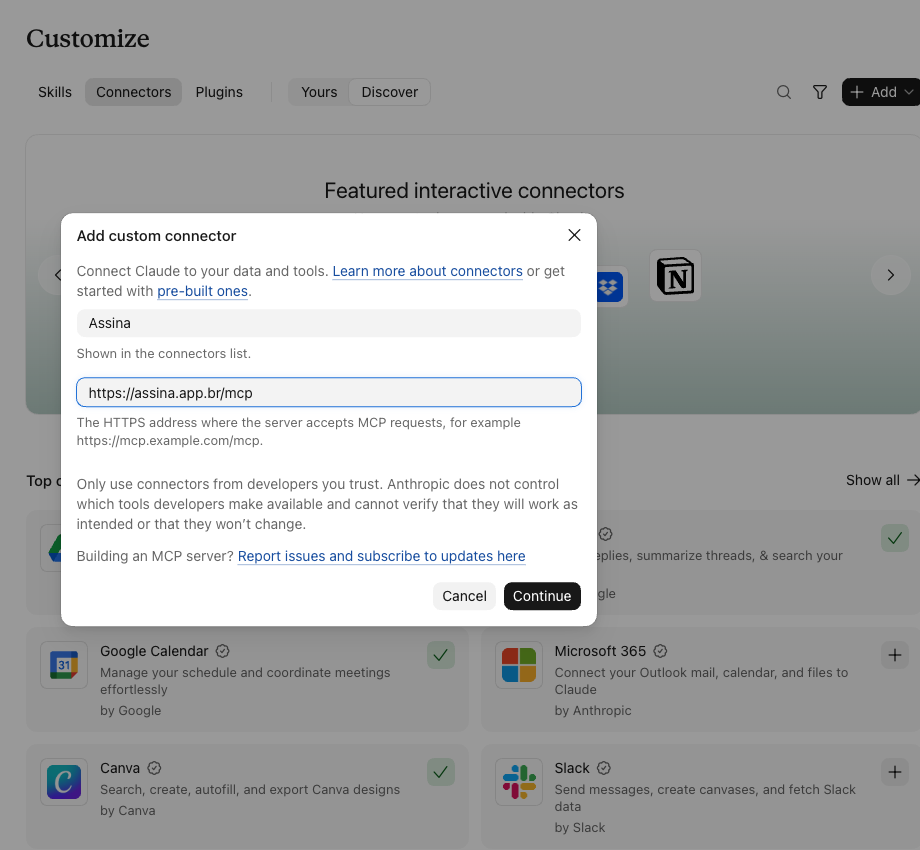
  &nbsp;
  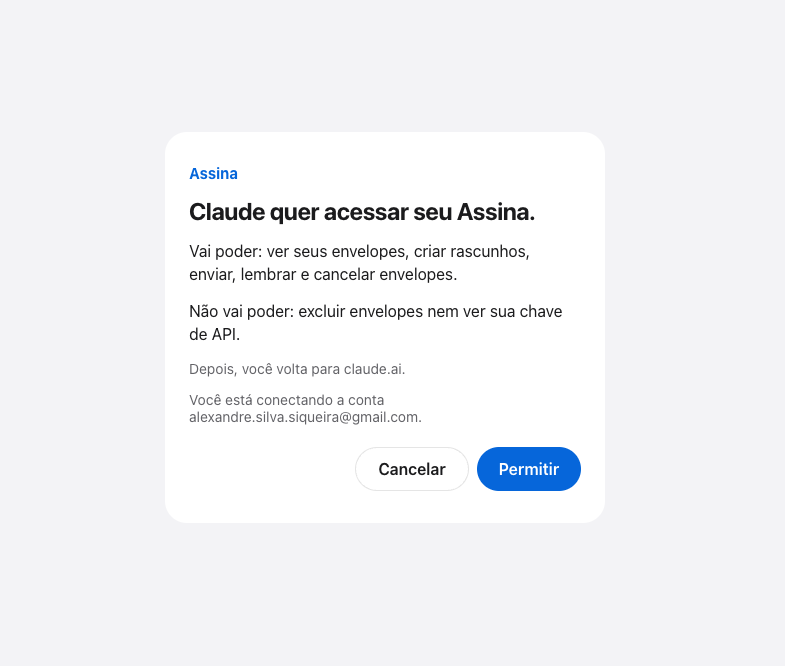
</p>

## Analytics no Visão do Produto (épico 8.11)

Os eventos da seção 21 do spec (`assina_*`) saem do servidor para o Visão do Produto, sem segurar a resposta: timeout de 4 s, e qualquer falha só fica no log como `analytics_falhou`. Nenhuma propriedade leva título, nome, e-mail, CPF, mensagem, motivo, IP, valor de campo ou nome de arquivo.

1. No Visão do Produto, crie o projeto **Assina** com o prefixo `assina_` e copie a chave de ingestão.
2. Na Vercel (e no `.env.local`, se quiser ver os eventos de dev), defina:
   - `VISAO_INGEST_URL`: o endereço `…/functions/v1/ingest` do Visão;
   - `VISAO_API_KEY`: a chave copiada.

   Sem as duas, nada é enviado.
3. Faça um envelope de teste ponta a ponta e confira em **Atividade**: `assina_envelope_criado`, `assina_envelope_enviado`, `assina_documento_assinado` e `assina_envelope_concluido`.

## Deploy na Vercel e faxina diária (épico 8.13)

1. **Projeto.** Importe `asiqueira1973/assina` na Vercel (conta DabLab). O framework é detectado como Next.js. Domínio: `assina.app.br`.
2. **Variáveis.** Copie todas as da tabela "Variáveis de ambiente" em **Production**, com `NEXT_PUBLIC_SITE_URL=https://assina.app.br`.
3. **Banco.** As migrations entram no Supabase remoto pelo MCP (seção "Banco"), antes do primeiro deploy.
4. **Cron.** O `vercel.json` agenda `GET /api/cron/diario` todo dia às 09:00 UTC (06:00 em Brasília). Com `CRON_SECRET` definido, a Vercel manda `Authorization: Bearer {CRON_SECRET}` sozinha. Sem o segredo certo, a rota responde 401.

A faxina faz, nesta ordem, e rodar duas vezes não reenvia nada:
1. expira os envelopes vencidos, avisa o remetente e entrega o webhook `envelope.expirado`;
2. manda os lembretes automáticos (a cada 2, 3 ou 7 dias, até 10 por pessoa);
3. retenta as finalizações paradas (até 3 tentativas no total);
4. retenta convites e avisos que falharam (até 5 tentativas);
5. retenta os webhooks (até 6 tentativas);
6. apaga os arquivos de recusados, cancelados e expirados encerrados há 90 dias;
7. apaga rascunhos parados há 30 dias;
8. apaga códigos OAuth vencidos e clientes OAuth sem nenhuma conexão há 7 dias.

A resposta traz a contagem de cada tarefa. Para rodar à mão:

```bash
curl -s -H "Authorization: Bearer $CRON_SECRET" https://assina.app.br/api/cron/diario
```

**Cabeçalhos de segurança.** Toda resposta leva `Content-Security-Policy`, `X-Frame-Options: DENY`, `X-Content-Type-Options: nosniff` e `Referrer-Policy` (`next.config.ts`). A CSP libera `https://*.r2.cloudflarestorage.com` para o upload e para o pdf.js ler o PDF. Se o R2 passar a usar outro domínio, ajuste lá.

## Vercel Firewall (limites por IP)

O app não conta requisições por IP: quem limita é o Vercel Firewall, configurado no painel da Vercel (projeto → **Firewall** → **Configure** → **New Rule**). Cada regra usa a condição **Request Path starts with**, a ação **Rate Limit** e a janela fixa de 60 s por IP. Acima do limite, a resposta é **429**.

| Caminho | Limite | Por quê |
|---|---|---|
| `/api/verificar` e `/verificar/` | 30 por minuto | critério 8.8: a consulta é pública (a página do código também consulta o banco) |
| `/api/assinar/` | 20 por minuto | página do signatário (código por e-mail) |
| `/api/v1/` e `/mcp` | 120 por minuto | integrações (épicos 8.9 e 8.10) |
| `/oauth/` | 30 por minuto | registro de cliente e troca de código (épico 8.10) |

Para conferir depois de criar, rode `for i in $(seq 1 35); do curl -s -o /dev/null -w "%{http_code} " "https://assina.app.br/api/verificar?codigo=AAAAAAAAAAAA"; done`: as primeiras 30 respostas são 200 e as seguintes, 429.

## Licença

[MIT](LICENSE). Referência funcional: [SignuDoc](https://github.com/NYLLON-SOFTWARE/signudoc) (MIT); todo código adaptado dele leva atribuição em `THIRD_PARTY_NOTICES.md`.

Feito pela [Dab Lab](https://www.dablab.com.br/), agência de inovação no-code para startups e PMEs, com automações usando IA.
